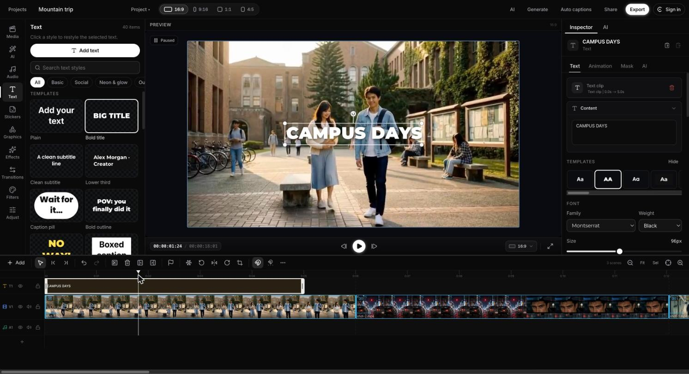
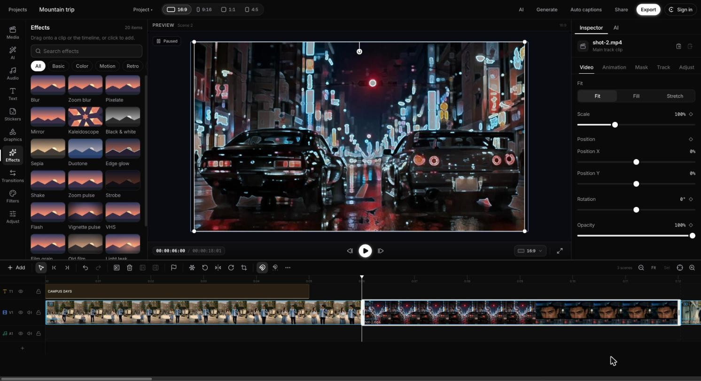
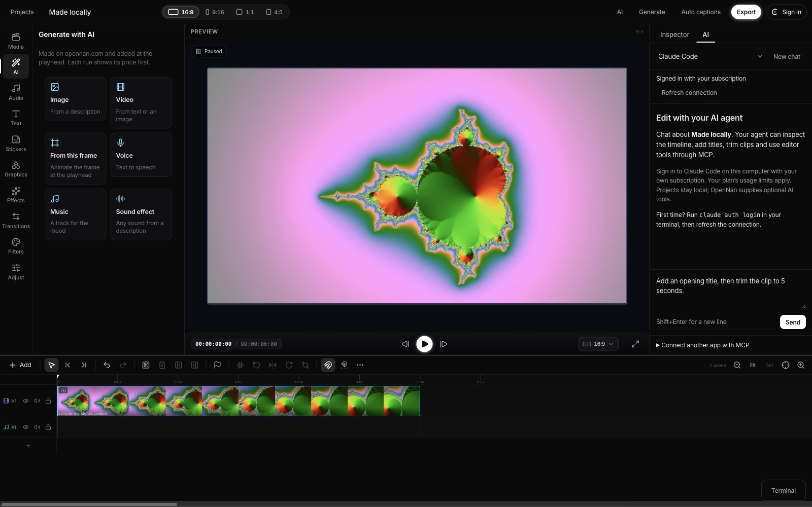

# OpennanStudio

<a href="https://opennan.com/"></a>

Created and maintained by **[Opennan](https://opennan.com/)**.

[Desktop app](apps/desktop/README.md) · [MCP for AI agents](packages/mcp/README.md) · [AI tool coverage](docs/ai-tool-coverage.md) · [Export](packages/export/README.md) · [Timeline engine](packages/timeline-core/README.md)

A free, source-available video editor for the web, macOS, Windows and Linux:
timeline, live preview, text, effects, transitions and MP4 export that runs on
your own machine. AI tools (image and video generation, voice, music, auto
captions) run on OpenNan or a provider you pick, and an MCP server lets Claude
Code, Codex CLI or any agent edit the open timeline.

## Editor

Actual screenshots of the running web app (`apps/web`) with three sample clips.



Add text from 40 templates, then edit its words, font, size and animation in the
inspector. The title is its own track above the video, so it trims and moves
like any clip.



Effects, filters, transitions and adjustments apply with one click and show in
the preview at once. Scale, position, rotation and opacity take keyframes, and
the same frames render in the export.



**Generate with AI** makes an image, a video, a voice line, music or a sound
effect and places it at the playhead. Each run shows its price first. Projects
stay on this device unless you save them to OpenNan cloud.

## Run locally

```bash
pnpm install
pnpm --filter @opennan/web dev        # the editor in a browser
pnpm --filter @opennan/desktop dev    # the desktop app (see apps/desktop/README.md for ffmpeg and whisper)
pnpm test                             # every package's tests
```

Node 20 or newer and pnpm 10.

## MCP

Claude Code, Codex CLI, Gemini CLI or any MCP client can edit a project:
about 40 editor tools that run offline, plus generation tools that run on
OpenNan (or another provider) once you sign in. Every tool call goes through the
editor's undo history, and a call that fails part way is undone.

```bash
pnpm install
pnpm exec turbo run build --filter=@opennan/mcp...
alias opennan-studio="node $PWD/packages/mcp/dist/cli.js"
opennan-studio project new film.opennan.json
opennan-studio mcp-config --client claude --project film.opennan.json --write   # or --client codex / gemini
opennan-studio login                                                             # only for the AI tools
```

Or add it to your MCP client yourself:

```json
{
  "mcpServers": {
    "opennan-studio": {
      "command": "node",
      "args": ["/absolute/path/to/OpennanStudio/packages/mcp/dist/cli.js", "mcp", "serve",
               "--project", "/absolute/path/to/film.opennan.json"]
    }
  }
}
```

`--http` serves `http://127.0.0.1:4319/mcp` with a bearer token instead of stdio,
and `--tools offline` lists only the editor tools. The desktop app has the same
server built in, plus a terminal panel that starts your agent already connected
to the open timeline. Full guide: [packages/mcp](packages/mcp/README.md).

| Tool | Operation |
| --- | --- |
| `read_timeline` | Read the project's tracks, clips, text and effects. |
| `list_media` | List the media in the project's library. |
| `create_timeline_clip` | Place media on a track at a time. |
| `split_timeline_clip` / `edit_timeline_clip` / `delete_timeline_clip` | Cut, trim, move and change clips. |
| `add_text_overlay` | Add a title or caption. |
| `apply_visual_effect` | Add an effect, filter or adjustment to a clip. |
| `generate_quick_image` / `generate_video_h3` | Make an image or a video and import it into the project. |
| `generate_tts` / `add_music` / `generate_sfx` | Make a voice line, music or a sound effect. |
| `preview_timeline_frame` | Render a still of any moment. |
| `assemble_video` / `get_export_status` | Export the MP4 and follow the job. |
| `undo_last_edit` | Undo the last whole tool call. |

## What's inside

- `packages/timeline-core`: framework-free timeline engine, canvas renderer, editing operations.
- `packages/timeline-media`: thumbnails, waveforms, frame decode, audio probe behind a `MediaEnvironment` (plus `/dexie` and `/effects` sub-entries).
- `packages/timeline-react`: `TimelineProvider`, `Timeline`, `Preview`, `ClipProperties`, and a precompiled `styles.css`.
- `packages/export`: local MP4 export (`compileExport` + native ffmpeg or ffmpeg.wasm runners), golden-tested against the preview.
- `packages/provider-sdk`: the AI provider interface: capabilities, `Job<T>`, `ProviderRegistry`, capability-gated UI helpers, and the `ai.run` runner (Apache-2.0).
- `packages/provider-local`: the free on-device provider: `audio.transcribe` with whisper.cpp and SHA-256 verified models (Apache-2.0, Node).
- `packages/provider-opennan`: Sign in with OpenNan (device flow), the account and credits, and AI jobs on the opennan.com public API; OpenNan is the default provider for every AI tool it offers.
- `packages/provider-fal`: fal.ai with your own key, for image and video generation (Apache-2.0, reference community adapter).
- `packages/cloud-backend`: OpenNan cloud projects: a `TimelineBackend` that edits a local working copy and syncs field-level changesets with opennan.com (polling, rebase, offline queue, per-device undo, deduplicated media uploads), and the `BackendRouter` that keeps local projects local.
- `packages/mcp-schema`: MCP tool names and JSON schemas generated from the editor commands (Apache-2.0).
- `packages/mcp`: MCP server for CLI agents (stdio, localhost HTTP, stdio bridge) and the `opennan-studio` CLI (`login`, `logout`, `whoami`, `mcp serve`, …); see `docs/ai-tool-coverage.md`.
- `apps/playground`: the editor on `LocalBackend` with sample media (`pnpm --filter @opennan/playground dev`).
- `apps/desktop`: the editor as a desktop app for macOS, Windows, and Linux: SQLite projects, media files on disk, MP4 export up to 4K on a bundled LGPL ffmpeg, on-device auto captions (whisper.cpp), a built-in MCP server, and a terminal panel for Claude Code, Codex CLI, Gemini CLI, or any command (see `apps/desktop/README.md`).
- `apps/web`: the free editor in a browser: projects, media import, timeline editing, keyboard shortcuts, and MP4 export, all local (`pnpm --filter @opennan/web dev`; `pnpm --filter @opennan/web build` writes static files and `THIRD_PARTY_NOTICES.txt` to `apps/web/dist`).

## Sign in with OpenNan

The account chip (top right) and Settings → AI providers open **Sign in with OpenNan**: the browser opens opennan.com with the code filled in, you click Approve, and Studio connects by itself (new to OpenNan: **Create account**). The chip shows your credit balance and **Buy credits**; **Switch account** and **Sign out** are in its menu, and signing out revokes the key Studio held. OpenNan runs every AI tool it offers unless you pick another provider per tool in Settings → AI providers (fal.ai with your own key, or the on-device whisper.cpp captions on desktop); story and storyboard tools are OpenNan only. Desktop keeps the key in the system keychain in the main process; the web app keeps it in this browser (IndexedDB with "Keep me signed in", else for the tab only) and signs in only from `studio.opennan.com` or localhost. Agents: `opennan-studio login` for `mcp serve`; the desktop app's MCP server uses the app's account.

## OpenNan cloud projects

Signed in, the Projects screen has two tabs: **On this device** (local projects, never uploaded) and **OpenNan cloud**. A local project's menu (or the editor's **Project** menu) offers **Save to OpenNan…**: its media is hashed and uploaded once (files the account already has are reused), and the project moves to the cloud with its ids. Open it on any device signed in to the same account. Edits land at once on this device and sync in the background; the top bar says **Saved**, **Syncing…**, **Offline (n pending)** (edits wait on this device and go out when OpenNan answers again), **Conflict** (an edit could not apply, for example its clip was deleted on another device; **Keep my version as a copy** makes a local project from the version before), **Sign in to sync**, or **Storage full**. Undo undoes this device's own edits only. **Download a local copy** makes an independent offline project. Cloud projects moved to the trash can be restored for 7 days. The free allowance is 2 GB of media and 250 MB of project data (account menu and Settings show the meter); over it, new media can't upload while edits still sync. Nothing about the cloud runs for a person who never opens the Cloud tab or a cloud project.

## `apps/web` limits

- Auto captions need an `audio.transcribe` provider, which the browser does not have: the dialog points to the desktop app. Generate (image or video from a description) runs on OpenNan or fal.ai.
- Generated media is downloaded into the project; the page's Content Security Policy allows downloads from `*.opennan.com` and fal.ai's file hosts only.
- The build writes its Content Security Policy as a `<meta>` tag; a host should also send `Content-Security-Policy: frame-ancestors 'none'` as an HTTP header (a meta tag cannot set it), so no other site can frame the editor.
- Projects and media live in this browser's IndexedDB only. The app asks the browser to keep them (`navigator.storage.persist()`); where the browser declines, it may delete them under storage pressure, so export finished videos.
- Media files up to 2 GB each. Exports (MP4/WebM, or an animated GIF) normally take the fast GPU path: the preview's WebGL2 renderer and WebCodecs in a worker, the encoded video streamed through the browser's private file system, ffmpeg.wasm only for the audio. Without WebGL2/WebCodecs, or for a codec the browser cannot decode, the compatible export runs `@opennan/export` on ffmpeg.wasm, up to 1080p, with up to 1 GB of media per export (larger projects get a `too-large` error; export them from the desktop app); it encodes MPEG-4 Part 2 unless the build opts in to libx264 (`VITE_WEB_EXPORT_ALLOW_GPL=true`, pending legal review). The dialog lists what an export leaves out (catalog GL effects on the web, custom-code graphics).
- The video encoder, the ffmpeg.wasm core (`@ffmpeg/core@0.12.10`, about 32 MB), is served by the app itself from `./ffmpeg-core/` and checked against its pinned SHA-256 before it runs, so export works offline.

## `apps/desktop` limits

- Unsigned builds for now (code-signing certificates pending): macOS asks for right-click → Open, Windows SmartScreen warns.
- The bundled ffmpeg is LGPL-only (no x264); H.264 comes from VideoToolbox, Media Foundation, VA-API, or OpenH264, else MPEG-4 Part 2 with a warning. The macOS build has no AV1 decoder.
- Auto captions download a whisper model (74-465 MB) on first use; no whisper.cpp build for Windows on Arm yet.

## Self-hosting the video encoder

The ffmpeg.wasm core is a separate static asset, never inside `apps/web/dist` or the JS bundle. `pnpm --filter @opennan/web build:ffmpeg-core` copies `@ffmpeg/core@0.12.10`'s `dist/esm` files to `apps/web/dist-ffmpeg-core/ffmpeg-core/`, refuses them unless their SHA-256 matches the hashes `@opennan/export/web` pins, and writes `NOTICE.txt`; deploy that folder at `<app>/ffmpeg-core/` (dev and preview serve it automatically). `VITE_FFMPEG_CORE_BASE` (build time) points the export at another copy, which must be byte-identical, or the app refuses to load it. The core is GPL-2.0-or-later (FFmpeg built with x264): hosting it means distributing GPL binaries, with the obligation to ship its notice and offer the corresponding source (the FFmpeg, x264, and ffmpeg.wasm sources and build scripts for that version). The `apps/web` build itself contains no GPL code (`pnpm check:licenses`).

## License

Free for personal use and for organizations under USD 5M annual revenue. See [LICENSE](LICENSE) and `LICENSES/`.
